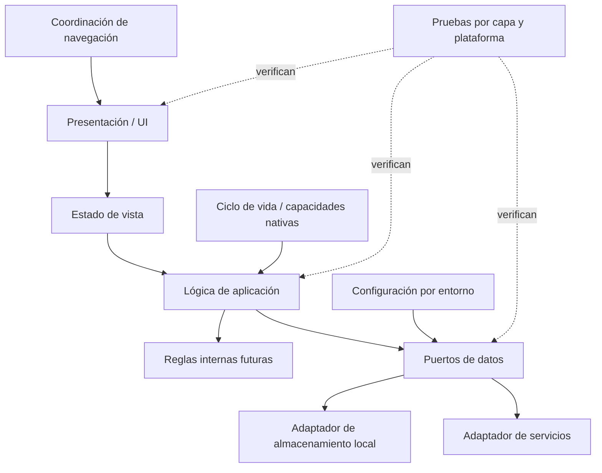

# Plan propuesto — Arquitectura base Móvil

**ID:** ARCH-MOV-BASE · **Decisión:** `propuesto` · **Ejecución:** `no_iniciado` · **Verificación:** `no_ejecutada` · **Tipo:** `—`.
Es una organización futura, no código, selección de stack ni definición de funcionalidad.

## Estructura conceptual

El diagrama no presupone que existan servicios ni selecciona mecanismo de navegación, estado, storage o framework.

## Alternativas no seleccionadas

- Framework, biblioteca de navegación, mecanismo de estado, almacenamiento y proveedor: no seleccionados por falta de plataforma, restricciones y decisión aprobada.
- Arquitectura con servicios concretos o pantallas funcionales: fuera de alcance de la arquitectura base documental.

## Responsabilidades

- **Presentación:** representa datos y eventos mediante controles semánticos; no decide autorización ni guarda directamente.
- **Estado:** expresa carga, resultado y error de forma determinista; separa estado efímero de estado duradero y de respuesta remota confirmada.
- **Aplicación:** coordina acciones abstractas y valida reglas de interfaz sin acoplarse a APIs de plataforma o proveedor.
- **Dominio:** aloja reglas futuras solo cuando una necesidad aceptada las defina; no se crean modelos funcionales en la arquitectura base.
- **Datos:** expone interfaces y traduce fuentes locales/remotas; políticas de caché, sincronización y conflictos requieren decisión.
- **Navegación:** separa transiciones de la presentación y considera retorno/restauración del ciclo de vida, sin definir mapa de pantallas.
- **Adaptadores nativos:** aíslan permisos, almacenamiento seguro u otras capacidades del sistema operativo solo cuando haya necesidad aprobada.
- **Configuración/seguridad:** distingue entornos, no empaqueta secretos de servidor, minimiza datos locales y controla permisos.

## Trazabilidad de requisitos

| Requisito | Sección del plan | Tarea futura | Validación futura |
|---|---|---|---|
| ARCH-MOV-01 | Responsabilidades: Presentación, Aplicación y Datos | MOV-AB-03 | Revisión de separación de responsabilidades |
| ARCH-MOV-02 | Responsabilidad Estado | MOV-AB-03 | Revisión de estados confirmados y duraderos |
| ARCH-MOV-03 | Responsabilidad Navegación | MOV-AB-04 | Revisión de retorno y estado recuperable |
| ARCH-MOV-04 | Responsabilidad Navegación y Adaptadores nativos | MOV-AB-04 | Revisión de ciclo de vida y permisos aplicables |
| ARCH-MOV-05 | Responsabilidades Presentación y Estado | MOV-AB-05 | Revisión de estados recuperables y datos expuestos |
| ARCH-MOV-06 | Responsabilidad Configuración/seguridad | MOV-AB-05 | Revisión de entornos y secretos |
| ARCH-MOV-07 | Responsabilidad Presentación | MOV-AB-05 | Checklist por criterios y plataformas aprobadas |
| ARCH-MOV-08 | Responsabilidades Adaptadores nativos y Configuración/seguridad | MOV-AB-05 | Revisión de amenazas y permisos |
| ARCH-MOV-09 | Responsabilidades Datos y Configuración/seguridad | MOV-AB-05 | Revisión de clasificación, caducidad y borrado |
| ARCH-MOV-10 | Responsabilidad Datos | MOV-AB-06 | Revisión de independencia y compatibilidad |
| ARCH-MOV-11 | Secuencia futura 1 | MOV-AB-01, MOV-AB-02 | Matriz de plataformas y restricciones |
| ARCH-MOV-12 | Validación futura | MOV-AB-06, MOV-AB-07 | Plan de pruebas y revisión humana |

## Cobertura de criterios de aceptación

| Criterio | Evidencia en spec | Evidencia en plan/task |
|---|---|---|
| AC-MOV-01 | §4 requisitos | Tabla de trazabilidad; MOV-AB-01..07 |
| AC-MOV-02 | §2 exclusiones | Alternativas y límites; MOV-AB-03, MOV-AB-04 |
| AC-MOV-03 | §2 exclusiones y §3 contexto | Alternativas no seleccionadas; MOV-AB-02 |
| AC-MOV-04 | §1 objetivo y §4 requisitos | Responsabilidades y riesgos; MOV-AB-05, MOV-AB-07 |
| AC-MOV-05 | §5 criterios | Validación futura; MOV-AB-06, MOV-AB-07 |

## Secuencia futura

1. Acordar plataformas, versiones, restricciones de dispositivos y stack con fuente de decisión.
2. Aprobar límites de presentación, estado, aplicación, datos y adaptadores.
3. Preparar estructura mínima y navegación vacía solo después de aprobación.
4. Establecer manejo de ciclo de vida, configuración, accesibilidad y errores generales.
5. Definir adaptadores y manejo de datos solo a partir de contratos aprobados.
6. Preparar pruebas por capa y una matriz de dispositivos/plataformas.
7. Revisar dependencias, seguridad, mantenibilidad y documentación.

## Validación futura

Revisión de dependencias, ausencia de secretos, configuración de entorno, navegación/restauración genérica, semántica/accesibilidad básica, comportamiento ante errores y pruebas de adaptadores/plataformas según tecnología acordada. No se ejecutó ninguna validación de producto en esta entrega.

## Riesgos y pendientes

No se asignan probabilidades ni impactos sin datos; se revisarán al cerrar el alcance.

| Riesgo | Probabilidad/impacto | Evidencia | Control propuesto | Responsable | Cierre |
|---|---|---|---|---|---|
| Stack y plataformas sin aprobación | No estimable en esta fase | MOVIL-D04 y MOVIL-D05 abiertos | Confirmar matriz y restricciones antes de seleccionar tecnología | PENDIENTE_DE_DESIGNAR | Decisión aprobada |
| Capacidades y almacenamiento sin requisito | No estimable en esta fase | Alcance futuro no definido | Evaluar amenaza, datos y permisos por capacidad | PENDIENTE_DE_DESIGNAR | Política documentada y validada |
| Contratos y disponibilidad del Backend pendientes | No estimable en esta fase | MOVIL-D06 abierto | Coordinar límites sin definir endpoints | PENDIENTE_DE_DESIGNAR | [Acuerdo de integración](../../docs/integracion-entre-proyectos.md) explícito |

## Dependencias y aprobaciones

Depende de la ratificación local MOVIL-D01 y de las decisiones MOVIL-D02 a MOVIL-D08 del [registro local](../../docs/decisiones-pendientes.md). `MOV-AB-07` incorpora `MOVIL-D06` y el acuerdo de integración propuesto con Backend. Cada tarea conserva sus dependencias explícitas en `task.md`; ninguna queda autorizada por este plan.
