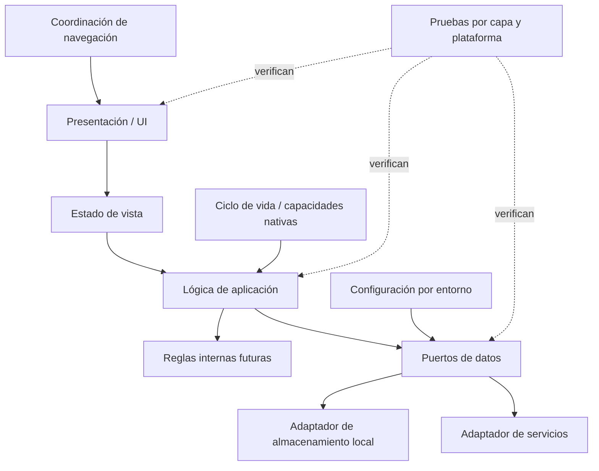

# Plan propuesto — Arquitectura base Móvil

**ID:** ARCH-MOV-BASE · **Decisión:** `propuesto` · **Aprobación:** pendiente.  
Es una organización futura, no código, selección de stack ni definición de funcionalidad.

## Estructura conceptual

El diagrama no presupone que existan servicios ni selecciona mecanismo de navegación, estado, storage o framework.

## Responsabilidades

- **Presentación:** representa datos y eventos mediante controles semánticos; no decide autorización ni guarda directamente.
- **Estado:** expresa carga, resultado y error de forma determinista; separa estado efímero de estado duradero y de respuesta remota confirmada.
- **Aplicación:** coordina acciones abstractas y valida reglas de interfaz sin acoplarse a APIs de plataforma o proveedor.
- **Dominio:** aloja reglas futuras solo cuando una necesidad aceptada las defina; no se crean modelos funcionales en la arquitectura base.
- **Datos:** expone interfaces y traduce fuentes locales/remotas; políticas de caché, sincronización y conflictos requieren decisión.
- **Navegación:** separa transiciones de la presentación y considera retorno/restauración del ciclo de vida, sin definir mapa de pantallas.
- **Adaptadores nativos:** aíslan permisos, almacenamiento seguro u otras capacidades del sistema operativo solo cuando haya necesidad aprobada.
- **Configuración/seguridad:** distingue entornos, no empaqueta secretos de servidor, minimiza datos locales y controla permisos.

## Secuencia futura

1. Acordar plataformas, versiones, restricciones de dispositivos y stack con fuente de decisión.
2. Aprobar límites de presentación, estado, aplicación, datos y adaptadores.
3. Preparar estructura mínima y navegación vacía solo después de aprobación.
4. Establecer manejo de ciclo de vida, configuración, accesibilidad y errores generales.
5. Definir adaptadores y manejo de datos solo a partir de contratos aprobados.
6. Preparar pruebas por capa y una matriz de dispositivos/plataformas.
7. Revisar dependencias, seguridad, mantenibilidad y documentación.

## Validación futura

Revisión de dependencias, ausencia de secretos, configuración de entorno, navegación/restauración genérica, semántica/accesibilidad básica, comportamiento ante errores y pruebas de adaptadores/plataformas según tecnología acordada. No se ejecutó ninguna validación de producto en esta entrega.

## Riesgos y pendientes

Stack y plataformas sin aprobación; matriz de compatibilidad por definir; capacidades nativas y políticas de almacenamiento dependen de requisitos futuros; contratos y disponibilidad del Backend pendientes. Coordinar por medio de [acuerdos de integración](../../docs/integracion-entre-proyectos.md).
